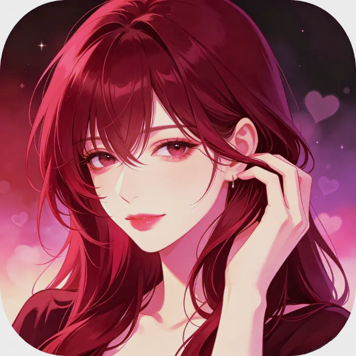

# DeepLink

> 一个纯前端的 AI 角色扮演聊天应用 —— 无框架、无构建、无服务器，一个文件夹就能跑。

DeepLink 是一个面向 Android 的 AI 聊天 / 角色扮演应用。它没有任何后端和构建工具链，
全部由纯 HTML + CSS + JavaScript 组成，数据存在本机，由用户自备大模型 API Key 驱动。



## 特性

- **多角色扮演**：角色卡、场景、关系、经历；支持多会话与多版本回复（重新生成保留历史版本，可前后切换）
- **长期记忆**：增量摘要 + 上下文注入，记忆与认知双层加密存放
- **多模型配置**：最多 6 套配置（接口地址 + API Key + 模型名），聊天页内一键切换
- **联网搜索**：可自行切换搜索源
- **多媒体**：发文件、图片、拍照、语音
- 相机、日记、音乐播放、搜索、导入导出、多主题与字体系统
- **适配 Chrome 83 老内核**（安卓 WebView 常见基线），兼顾真机上的视觉与交互细节

## 运行（浏览器 / 本地）

无需安装任何依赖，用浏览器打开 `index.html` 即可。
建议用本地服务运行（`localStorage` 在 `file://` 下行为不完全可靠）：

```sh
python -m http.server 8899
# 然后访问 http://localhost:8899
```

在浏览器里，应用会自动降级为「本地存储版」：所有跨平台原生能力（见下节）安全空转，其它功能照常。

## 配置 API Key

1. 打开 [DeepSeek 开放平台](https://platform.deepseek.com)，注册后创建一个 API Key（`sk-` 开头）
2. 在应用内进入「设置 → 主模型 → 配置一」，填入 API Key，滚动到底点「保存设置」
3. 点「连接自检」，出现「DeepSeek 直连：成功」即配置完成

默认接口为 `https://api.deepseek.com`。任何**兼容 OpenAI 接口**的平台都可以填入——
接口地址与模型名请到该平台官方文档里查（本项目不内置第三方地址清单，因为各家会变）。

## 打包成 APK

> ⚠️ 重要说明：本项目的目标形态是由**第三方「WebIDE」类封装工具**打进 Android APK。

打包后的应用通过封装工具注入的原生对象 `webapp`（`@JavascriptInterface`）获得额外能力：
无上限的原生存储、跟随系统的深色模式、屏幕常亮、状态栏变色、文件保存与分享、读取粘贴板等。

这意味着：

- **直接用浏览器打开** = 功能可用的「本地存储版」，一切正常，只是少了上面那些原生能力；
- **想要完整 APK**，需要自备同类封装工具，且该工具必须提供 `webapp` 这套接口。

代码里所有原生调用都经 `Store.callBridge()` 统一封装，**接口不存在或调用抛错都会安全空转**——
因此在浏览器、桌面、容器里行为完全一致，不会因为缺少原生接口而崩溃。

## 数据与隐私

- **所有数据只存在本机**（原生存储或 `localStorage`）。本项目没有、也不会把聊天内容上传到任何服务器。
- 网络请求只发往**你自己配置的模型接口**（默认 DeepSeek 官方），以及你主动使用搜索功能时选定的搜索源。
- 「记忆」的加密是**混淆，不是保密**——口令写在代码里。真正的保密靠你在「导出」时自设的口令。
- 请不要在公共网络下使用带明文凭据的调试工具。

## 免责声明

- 应用内所有 AI 生成内容由大模型产生，请自行甄别，不要用于任何违法或有害用途。
- 角色扮演相关内容为虚构演绎，与任何现实人物无关。
- 使用第三方模型服务时，请遵守对应平台的服务条款。

## 许可证

[MIT](LICENSE)

## 说明

本仓库为**源码开源版**：已移除作者个人联系方式与捐赠入口（这些内容保留在 APK 发行版中）。
