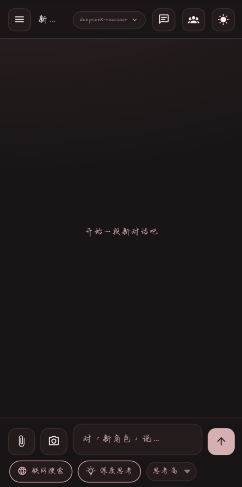
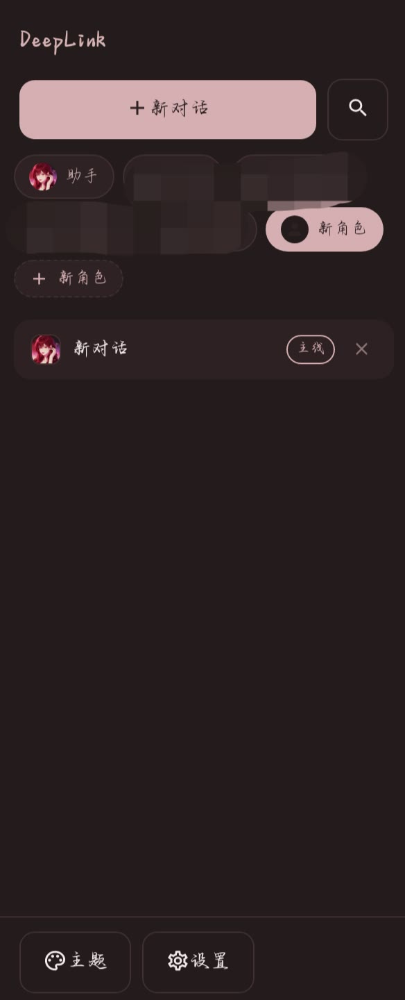

# DeepLink

> 一个 AI 角色扮演聊天应用 —— 无需构建、无需服务器，一个文件夹就能跑；
> 依赖容器提供的原生桥（文件读写 / 相册 / 相机 / 音频 / 通知），不是「纯前端」。

**无构建 · 无后端 · 依赖原生桥 · 数据只存本机 · 适配 Chrome 83 老内核**

当前版本：**6.2.7**

<p align="center">
  
  &nbsp;&nbsp;&nbsp;
  
</p>

DeepLink 是一个面向 Android 的 AI 聊天 / 角色扮演应用，全部由纯 **HTML + CSS + JavaScript** 写成，
没有任何后端和构建工具链；数据存在本机，由你自备的大模型 API Key 驱动。

项目由一位 **14 岁的初中生**利用课余时间、借助 **AI 辅助**（写代码、查资料、梳理文档、排错）完成。
初衷很朴素：想给自己造一个真正天天用得上、又完全在自己手里的 AI 聊天应用，顺便在这个过程中学点真东西。

## 特性

- **多角色扮演**：角色卡、场景、关系、经历；支持多会话与**多版本回复**（重新生成保留历史版本，可前后切换）；**回溯不丢内容**——以任意一条消息为界新建支线，原线原样保留
- **快捷回复 / 继续说**：AI 站在你的立场给 4 条「这时可以怎么回」（最多换 5 批）；角色回答可一键「继续说」接着往下讲
- **长期记忆**：增量摘要 + 上下文注入，记忆与认知双层加密存放；场景 / 关系 / 共同经历**日更**
- **故事时间系统**：给角色填出生日期与当前年龄定出合法时段，设定起点后 1:1 跟随现实；**年龄随故事时间增长**（满周岁 +1，时段跟着后移；提示词里给他的年龄也跟着走，不是卡片上那个静态值），出生日期可填到公元元年、填 0 表示无限年龄；主对话 / 手机 / 世界生成 / 摘要共用同一套时间；可开**混搭模式**（离开自动冻结、发第一条消息解冻）
- **多模型配置**：最多 6 套配置（接口地址 + API Key + 模型名），聊天页内一键切换
- **联网搜索**：可自行切换搜索源
- **多媒体**：发文件、图片、拍照、语音；AI 生成的角色图存进**角色个人图库**，可随导出 / 备份一起带走；视频 / 音乐 / 文档三类标记**只在和听澜（助手）对话时**出现
- **手机模式（类微信）**：发消息 / 转账 / 位置 / 图片 / 语音，**长回复自动拆成几条**；**伪电话**（拨号 → 角色接通 → 自动语音转文字）；
  **live2D 视频通话**（未配置则退回静态头像图）；**发布动态 + AI 自动筛选**（按标准检索、总结相关经过）；
  **多选转发 / 合并转发**（生成「聊天记录」卡片）/ 群聊 **@**（提醒谁看）；撤回时连带撤回那条回复，生成中直接中断
- **群聊**：多角色按性格动态分派发言；建群时**每位成员绑一条线**；「**对彼此的认知**」一个角色一条折叠条（再按「他看谁」二级展开，可开关、手动更新），可一键「**同步到各自线**」写进该角色那条线的记忆并跟着压缩；两种群都有**记忆压缩**
- **手机群**：手机页「+」→ 建群聊，与现实群**同一套规则但互不覆盖**（同一角色可在现实群绑 A 线、手机群绑 B 线）
- **群与线记忆互通（双向）**：读 —— 群里每位成员按自己绑定的线带上关系 / 经历 / 认知 / 记忆摘要 / **最近说过的原话** / 他自己的思绪 / 图库；写 —— 每轮结束把群里发生的事写回各自那条线（同一天同一群按标记替换，不会重复堆积）
- **表情包（只在手机）**：内置 48 个（图片，不是系统 emoji），手机输入栏笑脸进入；支持**自添加**（选图 → 挑张 → 选范围 → 导入），三档范围「都能用 / TA 用 / 自己用」决定谁能发，上限 50 个
- **表情双段式**：先把正文写完（先不发），再带着这段正文和他的性格单独挑一个表情，最后一起发出来，**表情是单独一条**；主聊天与现实群不出现表情
- **角色可自读资料（工具调用）**：开着时角色能自己调 `line_read`（本线的记忆摘要 / 思绪 / 图库 / 认知 / 最近原话）与 `line_search`（最近 100 条里找原话）；**只读当前这条线、纯只读**，模型不支持工具时自动退回普通回答。一处例外：`line_read` 的**图库是按角色取的**，同一角色在其它线画过的图也会被读到（图库本身是角色级资产，不按线切分）
- **TA 的思考**：时间系统开着时，角色随剧情自己记日级内心（按性格决定想什么：学者想学问、爱哲思的想抽象问题，也允许无厘头）。平时只存不读，每七个故事日压缩一次、压缩完让角色读一次；对话设置里可查看、可手动读取、可纠偏，读不读出来按性格
- **模型能力检测**：内置表 → 问模型自己 → 问不出来就先不限制上传类型；配了独立视觉 / 语音模型时上传类型跟着放开；手动勾选优先级最高
- **手机角色两类**：功能型（不校验设定，随手加个联系人就能聊）/ 相熟型（填齐必填栏，提示词约束「只通过手机联系」）；手机页还有**备忘录**，约定时间按故事时间到点提醒
- **检查更新**：读一份更新清单比对版本，启动时每天静默查一次，有新版本才提示（装前先导出备份）
- **背景可 AI 生成**：全局背景与本对话背景各一个入口，走设置里的画图模型，生成结果点保存才生效
- **世界生成（可关）**：离线一段时间后按天生成剧情，可逐天改 / 换一批 / 跳过；采纳后落成**居中剧情卡**，点开铺满全屏看全文
- **可开关玩法**：状态量化（气泡下方情绪数值框）、自动发信息（默认关，可改投手机）、会话级主动发消息（你俩在一块儿就不打扰）
- **助手总结 / 情绪日记**：主动问才出关系剖析报告；情绪日记按你写的内容引导角色
- 相机、日记、音乐播放、搜索、导入导出、**自定义聊天背景**、**酒馆角色卡导入**、多主题与字体系统
- **用量花费估算**：按类型细分用量并估算花费，含手机单独预警
- **适配 Chrome 83 老内核**（安卓 WebView 常见基线），兼顾真机上的视觉与交互细节

## 运行（浏览器 / 本地）

无需安装任何依赖，用浏览器打开 `index.html` 即可。
建议用本地服务运行（`localStorage` 在 `file://` 下行为不完全可靠）：

```sh
python -m http.server 8899
# 然后访问 http://localhost:8899
```

在浏览器里，应用会自动降级为「本地存储版」：所有跨平台原生能力（见下节）安全空转，其它功能照常。

## 配置 API Key

1. 打开 [DeepSeek 开放平台](https://platform.deepseek.com)，注册后创建一个 API Key（`sk-` 开头）
2. 在应用内进入「设置 → 主模型 → 配置一」，填入 API Key，滚动到底点「保存设置」
3. 点「连接自检」，出现「DeepSeek 直连：成功」即配置完成

默认接口为 `https://api.deepseek.com`。任何**兼容 OpenAI 接口**的平台都可以填入——
接口地址与模型名请到该平台官方文档里查（本项目不内置第三方地址清单，因为各家会变）。

## 打包成 APK

> ⚠️ 重要说明：本项目的目标形态是由**第三方「WebIDE」类封装工具**打进 Android APK。

打包后的应用通过封装工具注入的原生对象 `webapp`（`@JavascriptInterface`）获得额外能力：
无上限的原生存储、跟随系统的深色模式、屏幕常亮、状态栏变色、文件保存与分享、读取粘贴板等。

这意味着：

- **直接用浏览器打开** = 功能可用的「本地存储版」，一切正常，只是少了上面那些原生能力；
- **想要完整 APK**，需要自备同类封装工具，且该工具必须提供 `webapp` 这套接口。

代码里所有原生调用都经 `Store.callBridge()` 统一封装，**接口不存在或调用抛错都会安全空转**——
因此在浏览器、桌面、容器里行为完全一致，不会因为缺少原生接口而崩溃。

## 数据与隐私

- **所有数据只存在本机**（原生存储或 `localStorage`）。本项目没有、也不会把聊天内容上传到任何服务器。
- 网络请求只发往**你自己配置的模型接口**（默认 DeepSeek 官方），以及你主动使用搜索功能时选定的搜索源。
- 「记忆」在本机是**设备绑定的加密存放**（设备标识 + 每次安装随机生成的盐派生密钥），不是明文；但它挡的是「捡到手机随手翻」，不是对抗专业的数据提取。**换机、清 App 数据后原密文解不开**，所以请定期用「导出」备份（导出文件由你自设口令加密，口令不存进 App）。
- 请不要在公共网络下使用带明文凭据的调试工具。

## 已知边界

写在这里的都不是 bug，是刻意的取舍；知道它们能省掉一次误报。

- **手机页只显示手机群**：现实群在侧栏「现实扮演角色」里，不出现在手机列表、也不能在手机里聊。两边消息存的位置不同（手机群走 `phone.msgs`，现实群走 `messages`），混在一起会出现「手机里能聊、但模型和成员线都看不到」的黑洞。
- **没有加密接口的环境**（非 https 的浏览器、部分老内核）：记忆在本机是明文存放；导出与备份会降级成「口令混淆」而不是真加密，界面会明确提示一句。
- **备份在拿不到密文时保留明文**：宁可让备份里多留一份明文，也不清空——清空会导致「恢复出来是空的」。
- **Chrome 83 老内核**：flex 不能用 `gap`，不能用 `?.` / `??` / `replaceAll`。这是目标运行环境（安卓 WebView）的硬约束。
- **世界生成的天数没有硬上限**：离线很久时后段可能被模型长度上限截断，界面会提示。想缩短就先只补前两周。

## 免责声明

- 本项目是**本地客户端**：不提供 AI 服务、不运营模型、不设服务器，也不存储你的内容；对话由你自行配置的第三方接口生成。
- 应用内所有 AI 生成内容由大模型产生，请自行甄别，不要用于任何违法或有害用途。
- 角色扮演相关内容为虚构演绎，与任何现实人物无关。
- 使用第三方模型服务时，请遵守对应平台的服务条款。
- **数据风险自负**：卸载、覆盖安装、清除应用数据、设备损坏都可能导致本地数据丢失，请定期用内置的导出 / 自动备份功能备份。

## 许可证

本项目采用 **[PolyForm Noncommercial License 1.0.0](https://polyformproject.org/licenses/noncommercial/1.0.0/)**
（SPDX：`PolyForm-Noncommercial-1.0.0`），详见 [LICENSE](LICENSE)。

一句话概括：

- **非商业用途免费**：学习、研究、兴趣项目里随便用、随便改、随便分享；
- **必须署名**：分发时保留版权声明与许可文本，不许删掉作者名字；
- **商业用途需授权**：付费产品、付费服务、广告变现、企业内部商业运营等，请先发邮件说明用途。

商业授权联系：**zndm_laodeng@163.com**

> 许可全文以官方英文文本为准。换用它的原因：它由律师起草、被 SPDX 收录，条款与原先「署名 + 非商业免费 + 商用另议」的意思一致，
> 但把许可范围、终止条件、责任限制写得更清楚，也比自拟条款更经得起推敲。

## 说明

本仓库为**源码开源版**：已移除作者个人联系方式与捐赠入口（这些内容保留在 APK 发行版中）。
